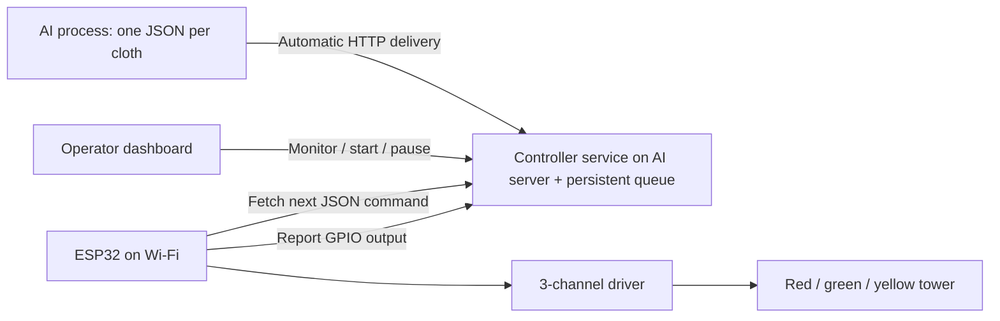

# Deployment and wiring

## Architecture



Only one table/device ID is supported per controller instance in version 1. Run the controller service alongside the AI process on its server, or on another reachable local computer. The AI process sends each result automatically to the service, and the ESP32 fetches validated JSON commands continuously from that server. The browser is only for setup, monitoring and line control. USB is used to flash firmware and inspect serial logs; operation uses Wi-Fi. The transport was not specified, so this version uses automatic HTTP delivery and polling; MQTT or an existing AI JSON endpoint would require an adapter once that interface is known.

## 1. Start and connect the controller

Use Node.js 24 or newer. From the project folder:

```powershell
npm start
```

In a second terminal, run `npm run keys`. These keys are distinct:

- **Operator**: dashboard, history, start/pause, settings.
- **Device**: fetch commands and report outputs only.
- **Vision**: automatically submit inspection results and AI liveness heartbeats.

They are randomly generated at first start and stored in `working-software/data/credentials.json`. Environment variables `OPERATOR_TOKEN`, `DEVICE_TOKEN`, `VISION_TOKEN` override the saved keys. Each must be different and at least 24 characters long. Default generated keys work with the dashboard configuration download. Preserve and protect the data folder; do not put credentials in Git or screenshots.

Find the computer's IPv4 address with `ipconfig`, such as `192.168.1.10`. Use **http://192.168.1.10:8090** in the ESP32 configuration. `localhost` on an ESP32 refers to the ESP32 itself. Assign the controller computer a DHCP reservation so its address remains stable. Allow incoming TCP 8090 in Windows Firewall for the private network if required. The ESP32 and server must be able to reach each other; guest Wi-Fi with client isolation commonly prevents this.

Environment settings:

| Setting | Default | Purpose |
| --- | --- | --- |
| `HOST` | `0.0.0.0` | Listen on LAN interfaces |
| `PORT` | `8090` | Dashboard and device API port |
| `DEVICE_ID` | `table-01` | Accepted device identity |
| `DATA_DIR` | `working-software/data` | Persistent keys and SQLite |
| `INBOX_DIR` | `working-software/vision-inbox` | Vision folder |
| `SIM_PORT` | `8091` | Independent simulator port |

## 2. Configure and flash the ESP32

Target board: classic ESP32 DevKit/WROOM-32, 4 MB flash. GPIO 25/26/27 are defaults for this board; do not use this pin map unchanged on an ESP32-C3, S2, S3, or a board with those pins allocated elsewhere.

The main software includes a USB build and upload workflow. Open **http://localhost:8090** on the computer running the desktop controller, connect the ESP32 with a USB data cable, and select **Configure ESP32**. Enter Wi-Fi, controller LAN address, GPIOs and polarity, then select **Build firmware**. The current controller device key is inserted automatically. Keep the line paused during firmware installation.

After a successful build, select **Refresh ports**, choose the ESP32's serial port, check the firmware replacement confirmation, and select **Upload to ESP32**. Follow progress in **Build & upload log**. Wait for the restarted device to report over Wi-Fi, then start the line. Settings changes require another build and upload. See [USB setup and troubleshooting](USB-SETUP.md).

The local toolchain is installed in this workspace. On a fresh Windows installation, run **Setup-ESP32-Tools.cmd** with Python 3.10+ and Internet access available. USB setup endpoints require the operator key and a localhost connection; LAN dashboard users can monitor the table but cannot flash USB devices. The selected port belongs to the controller computer, not a remote browser computer. Only one firmware operation runs at a time.

For a manual installation, select **Download settings file**, put the downloaded `table_config.h` in `esp-code/include/`, or copy/edit `table_config.example.h`. The template intentionally keeps outputs off if credentials are unconfigured. Build verification passed with both placeholder settings and an isolated configured build using test Wi-Fi credentials. Rebuild with your actual settings before installing.

Install PlatformIO from its official extension or Python package, open `esp-code/`, and use **Build**, **Upload**, and **Monitor**. The command-line equivalent is:

```powershell
pio run --project-dir esp-code
pio run --project-dir esp-code --target upload --upload-port COM5
pio device monitor --port COM5 --baud 115200
```

Replace COM5 with your board's port. The project pins Espressif32 6.10.0 and ArduinoJson 7.4.2 for repeatable builds.

This workspace also contains a locally installed verification toolchain, which you can use immediately:

```powershell
$env:PLATFORMIO_CORE_DIR = Join-Path (Get-Location) '.tools\pio-core'
& '.\.tools\pio-venv\Scripts\python.exe' -m platformio run --project-dir esp-code
& '.\.tools\pio-venv\Scripts\python.exe' -m platformio run --project-dir esp-code --target upload --upload-port COM5
```

Serial output prints connection/command status but never API keys or the Wi-Fi password. On Wi-Fi loss, invalid responses, authentication failures, stale reports, or HTTP errors, all outputs turn off. A separate watchdog task enforces the maximum 4.5-second unrenewed output lease even while an HTTP request blocks. The computer considers reports older than five seconds offline and pauses a running line.

## 3. Wire the signal tower

Check your tower's supply voltage, current, common wire type, and driver input specifications before selecting a relay or transistor module.

| ESP32 signal | Driver input | Driver output / tower wire |
| --- | --- | --- |
| GPIO 25 | IN1 | Red |
| GPIO 26 | IN2 | Green |
| GPIO 27 | IN3 | Yellow |
| GND | Input-side reference | As required by the driver specification |

ESP32 GPIO is 3.3 V logic. **Do not connect a 12 V / 24 V tower directly to a GPIO, and do not apply 5 V to a GPIO.** Use three driver channels compatible with 3.3 V control and rated for the tower current. A relay module whose inputs are pulled to 5 V is unsuitable without a proper interface. Supply the tower separately at its rated voltage. For dry relay contacts, switch the lamp's supply or return according to the tower specification; keep the tower supply isolated from ESP32 pins. For non-isolated transistor drivers, connect the logic and load grounds as required. Preserve galvanic isolation where the chosen module supports it.

For a common-negative DC tower, a suitable relay's COM can receive the fused positive tower supply and NO can connect to the lamp's positive wire; the common tower wire returns to supply negative. A common-positive tower instead needs switched returns. Consult the actual tower wiring rather than assuming either style. Use normally open contacts so de-energized relays leave the lamps off.

`RELAY_ACTIVE_LOW true` energizes a channel with LOW and releases it with HIGH. Set it to `false` for active-high drivers. Add appropriate external inactive-state pulls on driver inputs, consistent with their voltage ratings, so reset/boot floating pins cannot energize a lamp. Software initialization alone does not guarantee a power-on transient is prevented. A bare relay coil requires a transistor interface and flyback suppression.

The dashboard's Pause button is a network command, not a safety-rated emergency stop. Fit a physical isolation/stop circuit if the table requires one. No motors, scanner triggering, buzzer, repair actuation, or physical lamp feedback are included in this version.

## 4. Start the line

Connect the AI sender as described in [AI integration](AI-INTEGRATION.md). Wait for **ESP32 connected** and select **Start line** once. Each subsequent cloth result is received from the AI process and sent to the ESP32 automatically, even with the dashboard browser closed. Queue capacity is 1,000 unprocessed results. The ESP32 polls roughly every 400 ms, applies one classification, and immediately reports its output. The controller holds that inspection for the selected duration (1–30 seconds, default 3 seconds), then advances the queue. Actual switch timing includes network/poll latency. Adjacent results of the same category may keep the same lamp continuously on.

Between cloths, all outputs turn off on the next successful poll. The running line waits for the next AI result and processes it automatically. **Pause & lights off** interrupts the active result while retaining pending ones; use Start line to continue the pending queue. Interrupted results do not replay automatically. Clear pending queue is available only while paused and preserves the cancelled rows in history. To retry an interrupted result, have the AI/integration process explicitly submit it again with a new submission key.

Match the signal duration to actual table handling. The system preserves FIFO order rather than discarding earlier cloths. If AI results arrive faster than signals can be displayed, the queue grows and the dashboard shows the age of the oldest waiting cloth. For conveyor or high-rate operation, synchronize acquisition/cloth release with inspection completion before relying on a light to identify the cloth physically on the table.

## Docker / continued operation

```powershell
docker compose up -d --build
docker compose exec cloth-controller node scripts/show-keys.js
docker compose logs -f cloth-controller
```

The deployment image runs as a non-root user, has a health check, and restarts unless stopped. Only run one controller process against a given data folder; its connection state is deliberately held in that process. On Linux, ensure the mounted data and inbox folders are writable by container UID 1000. Docker was supplied as configuration but not executed in this workspace.

The supplied Docker image omits the firmware toolchain and USB access. For Docker operation, configure and flash the ESP32 beforehand using the manual workflow with the deployed controller's device key and LAN address. The built-in desktop installer automatically uses its own controller key; preserve that same credentials file if moving the controller to another host. For a non-Windows desktop install, create `.tools/pio-venv` with Python, install `platformio==6.1.18`, or set `PIO_PYTHON` to the full path of a Python interpreter with PlatformIO installed. `PLATFORMIO_CORE_DIR` optionally selects its cache directory.

For Windows without Docker, keep Start-Controller.cmd running; if unattended operation is needed, configure it to start at login with Windows Task Scheduler. A restarted controller always needs an operator to start the line again. Back up `working-software/data/` when the controller is stopped, including the credentials and database. Keep the service confined to a trusted LAN; HTTP tokens are not encrypted on the wire.
